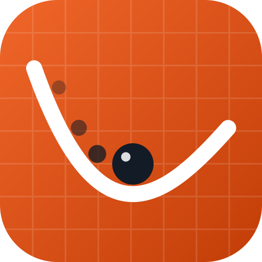

# Градиент

https://avtorhanov.github.io/Gradient/

Игра для изучения нейросетей с нуля: от одной формулы `ŷ = w·x + b` до своей мини-GPT на PyTorch.

- 4 этапа: **Основы → Сеть → Язык → GPT**
- 24 урока, в каждом один параметр или принцип
- 128 задач разных видов: ползунки и графики, расчёты, пары, порядок шагов, код на Python
- Уроки открываются по очереди, решённое возвращается в интервальное повторение (1, 3, 7, 16, 35 дней)
- Работает на телефоне и компьютере, светлая и тёмная тема

Вся игра — один файл `index.html`, без сборки и зависимостей.

## Иконка

Кривая ошибки и шарик, который скатился на её дно. Следы показывают шаги градиентного спуска: на крутом склоне шаги большие, у дна всё короче.

- `icon.svg` — исходник иконки;
- `apple-touch-icon.png` (180×180) — иконка на экране «Домой» iPhone и iPad (Safari → Поделиться → «На экран „Домой“»);
- `icon-512.png` — большая версия для превью и магазинов;
- значок вкладки браузера встроен прямо в `index.html`, поэтому работает и у локального файла.

## Запуск

**Локально:** откройте `index.html` в браузере.

**На GitHub Pages:**

1. Создайте на GitHub новый публичный репозиторий, например `gradient`.
2. Загрузите в него файлы: `index.html`, `README.md`, `.nojekyll`, `icon.svg`, `apple-touch-icon.png`, `icon-512.png` (кнопка **Add file → Upload files**).
3. Откройте **Settings → Pages**.
4. В разделе **Build and deployment** выберите **Source: Deploy from a branch**, ветку `main` и папку `/ (root)`, нажмите **Save**.
5. Через 1–2 минуты игра будет доступна по адресу `https://<ваш-логин>.github.io/gradient/`.

Через командную строку то же самое:

```bash
git init
git add index.html README.md .nojekyll icon.svg apple-touch-icon.png icon-512.png
git commit -m "Градиент: первая версия"
git branch -M main
git remote add origin https://github.com/<ваш-логин>/gradient.git
git push -u origin main
```

После этого включите Pages по шагам 3–4.

## Что нужно интернету

- Шрифты загружаются с Google Fonts. Без сети игра работает со системными шрифтами.
- Кнопка «Запустить» в задачах с кодом загружает Python (Pyodide, около 10 МБ) с `cdn.jsdelivr.net`. Если он не загрузится, задачи проверяются по тексту кода.
- Финальный урок с PyTorch запускается в [Google Colab](https://colab.research.google.com).

Прогресс хранится в `localStorage` браузера.

## Источники

Курс — пересказ общей базы из книг и курсов:

- Саймон Принс, «Understanding Deep Learning»
- Эндрю Траск, «Грокаем глубокое обучение»
- Себастьян Рашка, «Build a Large Language Model (From Scratch)»
- Гудфеллоу, Бенжио, Курвилль, «Глубокое обучение»
- Джей Аламмар и Маартен Грутендорст, «Hands-On Large Language Models»
- Андрей Карпатый, «Neural Networks: Zero to Hero»

Объяснения написаны своими словами; в каждом уроке указано, откуда взят приём.
